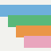
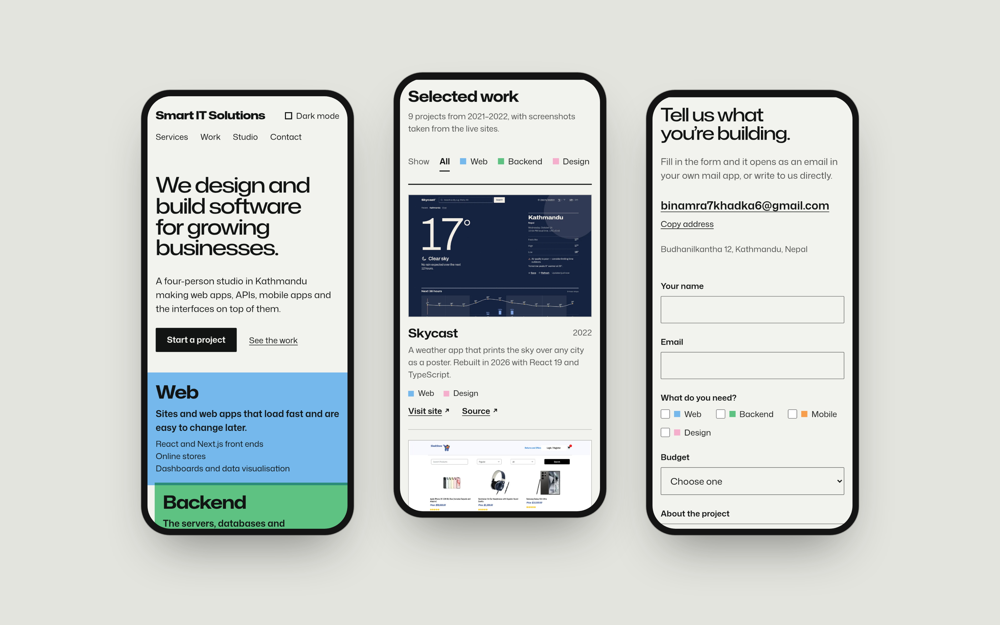
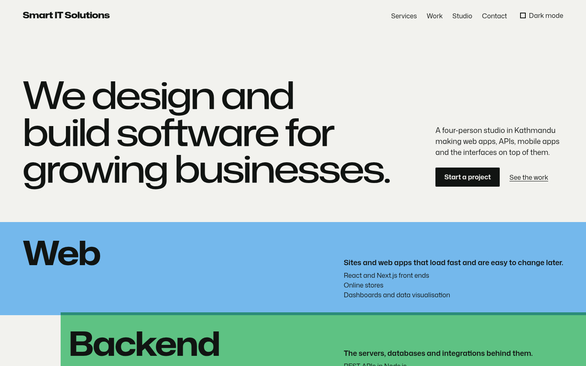
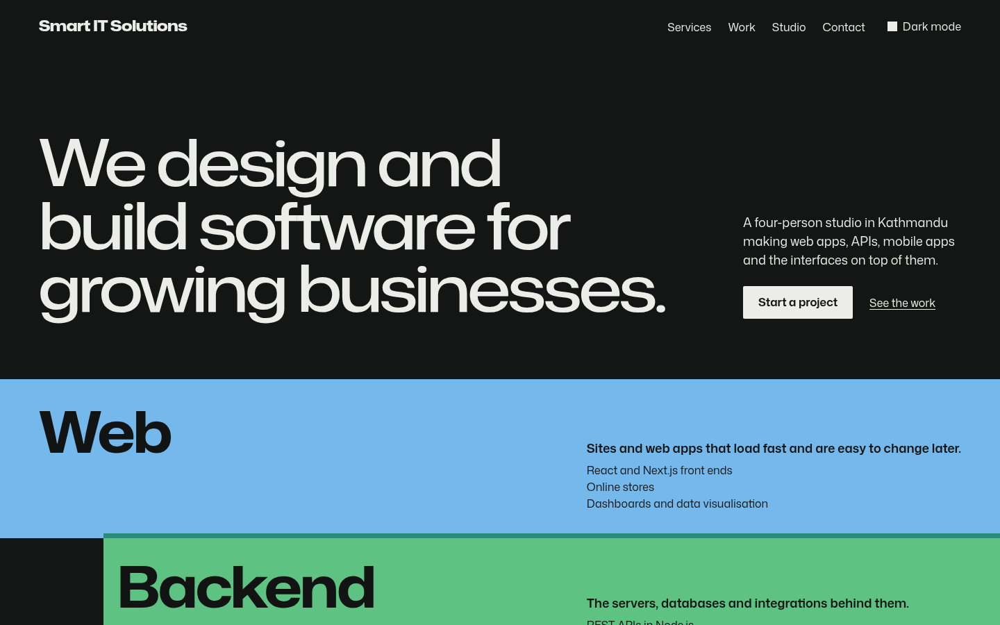
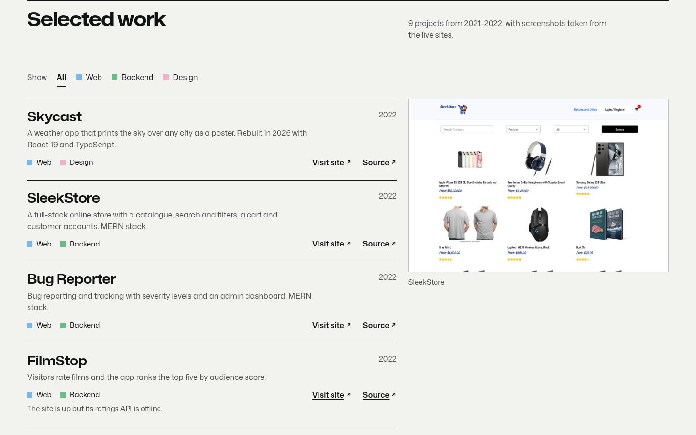
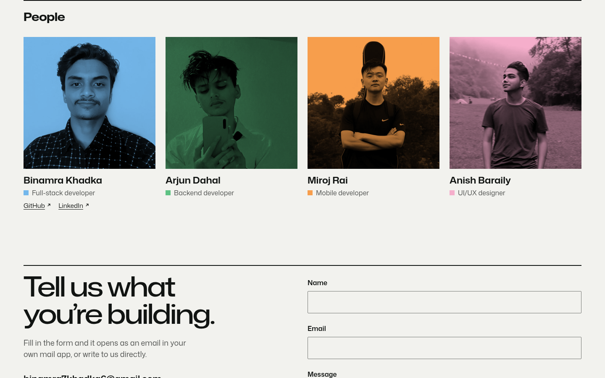

<div align="center">



# Smart IT Solutions

**A landing page for a four-person software studio in Kathmandu.**

Web, backend, mobile and design, each printed in its own spot ink, with a filterable index of<br />
real projects, a duotone team section and an enquiry form that writes the email for you.

[](https://react.dev)
[](https://www.typescriptlang.org)
[](https://vite.dev)
[](https://vitest.dev)
[](https://smart-it-solutions.vercel.app/)

[Live site](https://smart-it-solutions.vercel.app/) · [Screenshots](#screenshots) · [Features](#features) · [Getting started](#getting-started) · [Design](#design)

<br />



</div>

## The idea

The page is laid out like a sheet from a 1970s corporate identity manual: light paper, one black ink and four flat spot inks. Each discipline owns a colour, and the colour follows the work. The service bands, the project tags, the filter and the team photos all use the same four inks, so a glance tells you who does what.

<p align="center">
  
  
  
  
  
  
</p>

## Screenshots

Project thumbnails are screenshots of the live sites, captured on 14 October 2026.

<table>
  <tr>
    <td width="50%"></td>
    <td width="50%"></td>
  </tr>
  <tr>
    <td align="center"><sub>Hero and service bands</sub></td>
    <td align="center"><sub>Dark mode</sub></td>
  </tr>
  <tr>
    <td></td>
    <td></td>
  </tr>
  <tr>
    <td align="center"><sub>Project index with live preview</sub></td>
    <td align="center"><sub>Duotone team</sub></td>
  </tr>
</table>

## Features

**Work**

- Filter the nine projects by discipline. Hovering or focusing a row shows its screenshot in a sticky preview.
- Projects whose deployment is gone say so and link to their source instead of a dead site.

**Contact**

- The enquiry form validates inline, moves focus to the first problem, then opens the visitor's mail app with a pre-written email (name, email, message). No backend or third-party form service.
- One-click copy of the address.

**Everywhere**

- Light and dark themes. The page follows the system until the visitor picks one, and the choice is applied before first paint.
- Keyboard and screen-reader friendly: skip link, real headings, `aria-pressed` filters, live region for the list and form status.
- `prefers-reduced-motion` turns off the one entrance animation (the bands printing in).

## Getting started

Requires Node 22.12 or later.

```bash
git clone https://github.com/Binamra7/smart-it-solutions.git
cd smart-it-solutions
npm install
npm run dev        # http://localhost:3000
```

<details>
<summary>Scripts</summary>

| command           | does                             |
| ----------------- | -------------------------------- |
| `npm run dev`     | Vite dev server                  |
| `npm run build`   | typecheck, then build to `dist/` |
| `npm run preview` | serve the build                  |
| `npm test`        | Vitest, once                     |
| `npm run lint`    | ESLint                           |
| `npm run format`  | Prettier                         |

</details>

<details>
<summary>Deploying</summary>

`vercel.json` sets the Vite framework preset, `npm ci` and the `dist` output. The Node version comes from `engines` in `package.json`. If the Vercel project still has an old Node version pinned in its settings, change it to 22.x or 24.x.

</details>

## How it works

Everything is static. Content lives in one typed file, so editing the studio's copy, projects or team never touches a component.

```
src/
├── content.ts            disciplines, projects, team, principles, contact
├── components/           Masthead, Hero (incl. service bands), Work, Studio, Contact, Footer
├── lib/theme.ts          theme hook (system default, stored override)
├── lib/mailto.ts         enquiry validation and mailto builder
└── styles/               tokens.css (all colour and type), global.css
```

## Design

- **World:** a corporate identity manual in four spot inks (Otl Aicher's Munich 1972 colours, Wim Crouwel's grids).
- **Type:** Mona Sans only, using its width axis: 125% for headlines, 100% for body. Nothing below 14px.
- **Contrast:** primary text at least 8:1 and secondary at least 7:1 on every field, checked numerically.
- **No boxes:** 2px rules open sections, 1px rules separate rows, and there are no cards or shadows.

The full direction, palette table and refuse list are in [`DESIGN.md`](DESIGN.md). Tokens are in [`src/styles/tokens.css`](src/styles/tokens.css).

## Testing

```bash
npm test
```

Covers the discipline filter, offline-project links, form validation and focus, the remembered theme, and the mailto builder.

## Acknowledgements

- [Mona Sans](https://github.com/github/mona-sans) by GitHub, SIL Open Font License, self-hosted via Fontsource.
- Inspired by Otl Aicher's identity for the 1972 Munich Olympics and Wim Crouwel's posters for Total Design.
